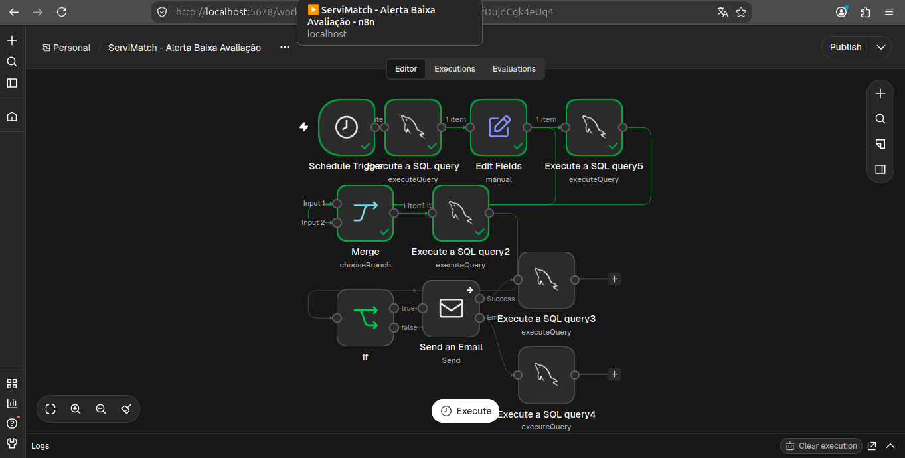

## OBJETIVO: 
Automação desenvolvida para notificar automaticamente quando um usuário possui uma avaliação abaixo de duas estrelas em uma troca concluída no aplicativo.

Essa automação tem como principal objetivo alertar aos os usuários a reputação de suas contas dentro do aplicativo.

## VISÃO GERAL: 
A automação integra o banco de dados MySQL e o n8n, para comunicação entre os sistemas e SMTP

Após o envio de uma avaliação baixa no aplicativo e a mesma ser salva no banco de dados, o n8n realiza uma busca na tabela de reviews_alerts para cruzar informações sobre os dois usuários envolvidos na avaliação.

Com isso ele realiza a validação para inserir a confirmação do envio do email na tabela de reviews_alerts, evitando duplicidade no envio das notificações.

## ARQUITETURA DO WORKFLOW: 
 

## FUNCIONAMENTO: 
# NÓ 1 : Schedule Trigger
Responsável por programar a execução do workflow a cada cinco minutos

# NÓ 2: My SQL
Responsável por realizar a busca dos dados dos usuários que possuem uma avaliação menor igual a 2.

## NÓ 3: EDIT FIELDS 
Responsável por realizar a criação do reservation token, no qual possibilita organizar os dados do processo de avaliação,o reservation_token é gerado individualmente para cada participante e execução.

## NÓ 4: My SQL 2
Responsável por inserir o registro da avaliação já com o reservation token dentro da tabela review_alerts, visando evitar duplicidade no envio de emails. 

## NÓ 5: MERGE 
Possibilita conectar e preservar os dados do nó edit fields para utilização nos demais nós sqls da aplicação, ele também aguarda a conclusão das duas ramificações, garantindo que o INSERT IGNORE tenha sido processado antes da verificação da reserva.

## NÓ 6: My SQL 
Responsável por realizar a busca do registro dentro da tabela de review_alerts, devolvendo colunas da tabela que armazena dados de quem avaliou, quem recebeu a avaliação e comentários da avaliação, que serão utilizados em nós posteriores do workflow

## NÓ 7: IF
Nó que possibilita avaliar se o a troca possui um token de reserva válido para o workflow executar o envio do email com segurança.

## NÓ 8: SEND AN EMAIL
Nó que possibilita realizar a configuração do envio de emails para usuários envolvidos na troca e também do protocolo SMTP.

Se apresentar algum erro no envio ele direciona uma conexão para o nó sql que permite incluir as informações do erro no banco de dados e realizar a atualização de status do envio daquela notificação na tabela de review_alerts. 

Se não apresentar nenhum erro o segundo nó sql executa um UPDATE para a tabela de review_alerts, para atualizar status de envio do email para os usuários envolvidos na avaliação abaixo da média.

## PRINCIPAIS DESAFIOS TÉCNICOS E SOLUÇÕES
## DESAFIO 1
Durante a execução do workflow fiquei com dúvidas de como faria para realizar a busca por avaliações abaixo da média.

## SOLUÇÃO 1
Com isso acabei analisando as possibilidades que poderia implementar e cheguei a conclusão de adicionar uma busca condicional no nó 2 do sql que filtra a busca por avaliações com número menor igual a dois.
