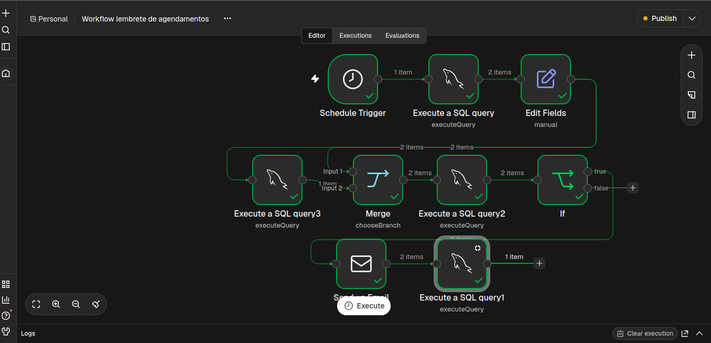

## DOCUMENTAÇÃO WORKFLOW 3 N8N SERVIMATCH

## OBJETIVO: 
Automação desenvolvida para notificar automaticamente quando um usuário possui um agendamento marcado para uma troca com outro prestador de serviço.
## VISÃO GERAL: 
A automação integra o banco de dados MySQL e o n8n, para comunicação entre os sistemas e SMTP

Após a criação de um agendamento no banco de dados, o n8n realiza uma busca na tabela de exchange_proposals para cruzar informações sobre os dois usuários envolvidos na troca,com isso ele realiza a validação para inserir a confirmação do envio do email na tabela de exchange_reminders, evitando duplicidade no envio das notificações.

## ARQUITETURA DO WORKFLOW: 
 

## FUNCIONAMENTO: 
# NÓ 1 : Schedule Trigger
Responsável por programar a execução do workflow a cada cinco minutos

# NÓ 2: My SQL
Responsável por realizar a busca dos dados dos dois usuários envolvidos na troca e também as informações presentes no processo de agendamento,a consulta seleciona agendamentos com status scheduled cuja data esteja entre 24 horas e 24 horas e 10 minutos a partir do horário UTC atual.

## NÓ 3: EDIT FIELDS 
Responsável por realizar a criação do reservation token, no qual possibilita organizar os dados do processo de agendamento,o reservation_token é gerado individualmente para cada participante e execução.

## NÓ 4: My SQL 2
Responsável por inserir o registro da troca já com o reservation token dentro da tabela exchange_reminders, visando evitar duplicidade no envio de emails. 

## NÓ 5: MERGE 
Possibilita conectar e preservar os dados do nó edit fields para utilização nos demais nós sqls da aplicação, ele também aguarda a conclusão das duas ramificações, garantindo que o INSERT IGNORE tenha sido processado antes da verificação da reserva.

## NÓ 6: My SQL 
Responsável por realizar a busca do registro dentro da tabela de exchange_reminders, devolvendo colunas de email e nome, que serão utilizados em nós posteriores do workflow

## NÓ 7: IF
Nó que possibilita avaliar se o a troca possui um token de reserva válido para o workflow executar o envio do email com segurança.

## NÓ 8: SEND AN EMAIL
Nó que possibilita realizar a configuração do envio de emails para usuários envolvidos no agendamento também do protocolo SMTP.

Se apresentar algum erro no envio ele direciona uma conexão para o nó sql que permite incluir as informações do erro no banco de dados e realizar a atualização de status do envio daquela notificação na tabela de exchange_reminders. 

Se não apresentar nenhum erro o segundo nó sql executa um UPDATE para a tabela de exchange_reminders, para atualizar status de envio do email para os usuários envolvidos naquele agendamento.

## PRINCIPAIS DESAFIOS TÉCNICOS E SOLUÇÕES
# DESAFIO 1
A principio encontrei um desafio de como faria para evitar que uma notificação fosse disparada varias vezes para um mesmo usuário, como o sistema iria identificar que aquele usuário já foi notificado com aquela informação ?

# SOLUÇÃO 1
Para isso desenhei a modelagem da tabela exchange_reminders que possibilita organizar essa informação com precisão, o fluxo do workflow é executado com base nos registros inseridos nessa tabela, o que permite atráves de uma validação cautelosa distinguir se um usuário realmente tem necessidade de receber outro email com a mesma informação. 

# DESAFIO 2 
Uma dúvida que surgiu no final do workflow foi como poderia tratar erros caso o email não fosse enviado corretamente.

# SOLUÇÃO 2
Para isso identifiquei a opção de adicionar uma conexão com um nó sql que possibilita organizar o status do registro no banco de dados em caso de um erro ao realizar o envio do email para o usuário.

