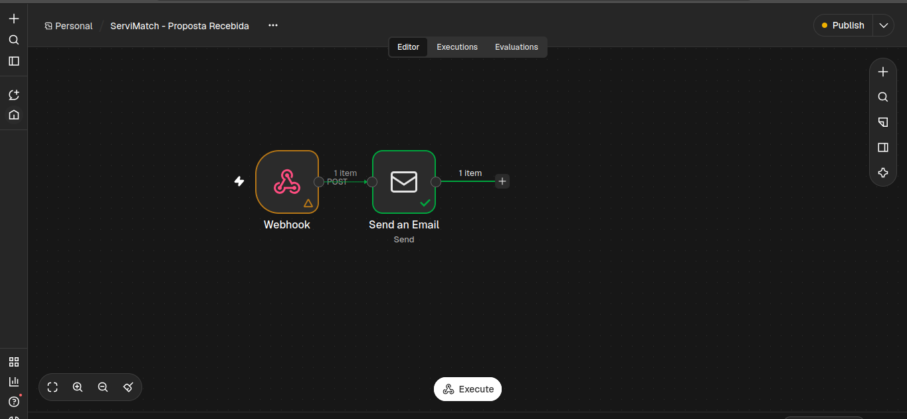

## DOCUMENTAÇÃO WORKFLOW 2 N8N SERVIMATCH

## OBJETIVO: 
Automação desenvolvida para notificar automaticamente quando um usuário recebe uma proposta de troca de outro usuário pelo servimatch.

## VISÃO GERAL: 
A automação integra o backend Node.js/express, o banco de dados MySQL e o n8n, utilizando WebHooks para comunicação entre os sistemas e SMTP

Após a criação de uma proposta no banco de dados, o backend recupera as informações necessárias e envia uma requisição HTTP POST ao n8n, que processa os dados e realiza o envio automático da notificação ao destinatário.

## ARQUITETURA DO WORKFLOW: 
 

## FUNCIONAMENTO: 
# NÓ 1 : Web hook
Responsável por receber as requisições HTTP POST enviadas ao backend. 

Também utiliza autenticação Header Auth, na qual exige um segredo compartilhado enviado pelo backend por meio do cabeçalho HTTP

# NÓ 2: Send an Email
Configura e estrutura envio de email automático para o usuário que   recebeu a proposta, utiliza os dados recebidos pelo WebHook para preencher dinamicamente as informações de notificação, como: 

# Nome do usuário que enviou a proposta
# Nome do destinatário
# Serviço oferecido
# Serviço solicitado
# Mensagem enviada junto a proposta 

## INTEGRAÇÃO COM O BACKEND
Foi implementado um módulo de integração responsável por realizar a comunicação HTTP entre backend e o n8n. 

Aṕos a persistência da proposta no MySQL, o backend recupera os dados necessários para a notificação e realiza uma requisição POST autenticada ao WebHook.

A integração utiliza variáveis de ambiente para armazenar a URL de produção e o segredo de autenticação. 

RESULTADO: Workflow executado e validado com sucesso, realizando o recebimento dos dados da proposta pelo webhook e o envio automático de notificações por e-mail ao usuário destinatário.