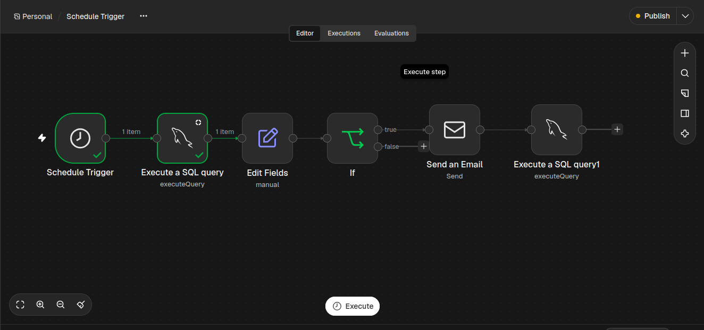

## DOCUMENTAÇÃO WORKFLOW N8N SERVIMATCH

## OBJETIVO: 
 AUTOMAÇÃO DESENVOLVIDA NO N8N PARA NOTIFICAR AO ADMINISTRADOR VIA EMAIL QUANDO UM NOVO SERVIÇO É CADASTRADO NA PLATAFORMA, VISANDO FACILITAR O ACOMPANHAMENTO DAS ATIVIDADES, MANTER O CONTROLE DOS SERVIÇOS PUBLICADOS E DO PROCESSO DE IDENTIFICAÇÃO DE NOVOS CADASTROS. 

## VISÃO GERAL: 
  O WORKFLOW UTILIZA SCHEDULE TRIGGER PARA UMA BUSCA SQL A CADA CINCO MINUTOS BUSCANDO SERVIÇOS QUE AINDA NÃO FORAM REGISTRADOS NA TABELA AUXILIAR DE MONITORAMENTO, EM SEGUIDA OS DADOS DO SERVIÇO E DO PRESTADOR SÃO ORGANIZADOS E ENCAMINHADOS PARA O NÓ IF, QUANDO UM NOVO SERVIÇO É IDENFICADO UMA NOTIFICAÇÃO É EMITIDA AO ADMINISTRADOR VIA E-MAIL

## ARQUITETURA DO WORKFLOW: 
 

## FUNCIONAMENTO: 
# NÓ 1 : schedule trigger
Nó responsável por definir a frequência de execução do workflow que realizar a execução automaticamente a cada cinco minutos.

# NÓ 2: SQL QUERY 1 
responsável por realizar a busca de serviços cadastrados que ainda não foram registrados na tabela de  servicos_monitorados. 

## NÓ 3: EDIT FIELDS
responsável por organizar estrutura de dados retornado da primeira consulta sql, preparando as informações necessária para a proxima etapa necessária do workflow 

## Nó 4: IF
responsável por validar a existência do id de serviço da primeira busca sql, 

TRUE: encaminha dados para a etapa de notificação 
FALSE: encerra processamento

## Nó 5: Send an Email
Configura e estrutura envio de email para o administrador do produto

## Nó 6: SQL QUERY 2
Valida busca de monitoramento do serviço cadastrado no banco de dados

RESULTADO: Workflow executado com sucesso, realizando a identificação de novos serviços e o envio automático de notificações administrativas.